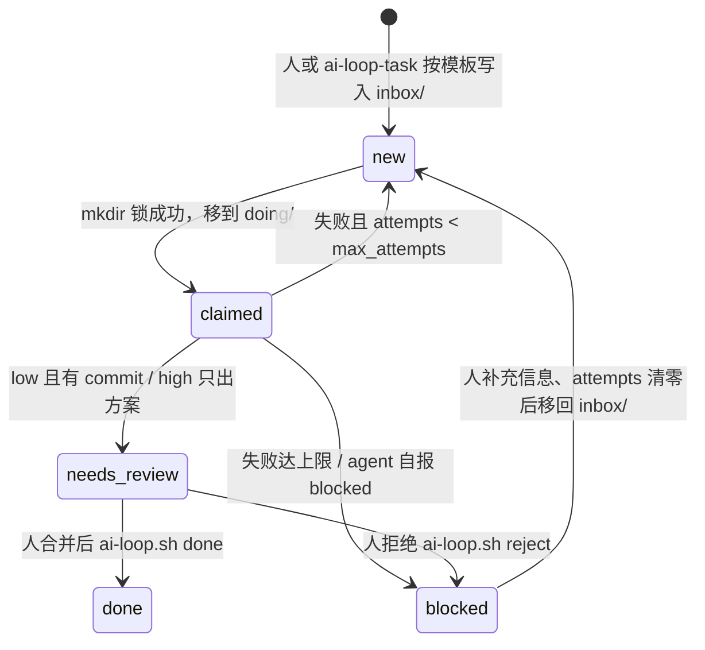
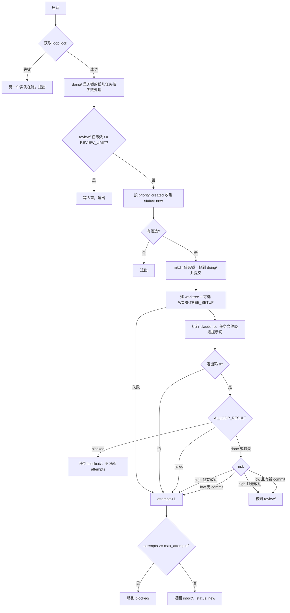

# 架构说明

本仓库用「本地 markdown 任务池 + 独立 worktree」驱动 AI 循环。核心约束：**AI 只产出结果，合并不自动化**。
本文件说明目录职责、任务流转、文件格式、两种运行方式、可调参数和尚未验证的风险。

参考来源：`docs/reference/magpie-ai-loop-guide.md` 第 5 节「落地方案」（参考资料；其中的 `.ai/README.md`、
`.ai/STANDARDS.md`、`.claude/settings.json`、skills 等建议没有落地，验收标准改由 `docs/code-standards.md` 承担）。

## 1. 目录与文件职责

```
.
├── CLAUDE.md                 # 只含 @AGENTS.md（一个入口）
├── AGENTS.md                 # 路由表 + 硬性规矩（护栏只写在这里）
├── LESSONS.md                # 错题本：近期踩坑，≤5 条，3 次复发后毕业
├── README.md                 # 人看的快速开始
├── .claude/loop.md           # 交互会话（/loop）每轮提示词，状态归 agent 管
├── .ai/
│   ├── inbox/                # 新需求 / bug（status: new；人手写或 ai-loop-task），含 EXAMPLE-*.md 示例（status: example，可删）
│   ├── doing/                # 已被认领（status: claimed）
│   ├── review/               # 等人审（status: needs_review）
│   ├── done/                 # 人确认合并后归档（status: done）
│   ├── blocked/              # 失败达上限、需求不清、被人拒绝（status: blocked）
│   └── templates/task.md     # 任务模板
├── scripts/
│   ├── ai-loop.sh            # claude -p 无人值守脚本 + done / reject / check 子命令
│   └── test-ai-loop.sh       # 回归测试（临时仓库 + 假 claude）
└── docs/
    ├── ARCHITECTURE.md       # 本文件
    ├── code-standards.md     # 验收标准、提交信息、复盘、毕业规则
    └── reference/            # 参考资料（magpie-ai-loop-guide.md）
```

运行时产物（已 gitignore）：

| 路径 | 作用 |
| --- | --- |
| `.ai-locks/<id>/` | 单任务认领锁（`mkdir` 原子性） |
| `.ai-locks/loop.lock/` | 脚本全局锁，保证同机只有一个脚本实例 |
| `.ai-logs/<id>.result.json` | `claude -p --output-format json` 的输出 |
| `.ai-logs/<id>.stderr.log` / `<id>.setup.log` | agent stderr / `WORKTREE_SETUP` 输出 |
| `.worktrees/<id>/` | 任务 worktree（默认在仓库内，id 不会跨仓库冲突） |

## 2. 任务生命周期

状态只有 6 个，**目录即状态**：`new`（inbox）→ `claimed`（doing）→ `needs_review`（review）→ `done`；
`blocked`（blocked）。`example` 只用于示例文件。没有 `in_progress` / `rejected`：拒绝 = 进 `blocked/` 并留下拒绝记录。



规则：

- `status` 必须与所在目录一致，`scripts/ai-loop.sh check` 会校验（不一致时退出码为 1）。
- 代码改动只在 `.worktrees/<id>`，分支 `ai/<id>`；文件名 = `<id>.md`。
- **合并由人执行**。脚本和 agent 都不执行 `git merge`、`git push`。
- `review/` 达到上限（默认 3）时停止领取新任务。
- 状态迁移的 commit 只包含该任务文件（`git commit -- <paths>`），不会带走 inbox 里的草稿或你已 staged 的其他改动。
  它们提交在当前所在分支上（主 checkout）；不想让历史里出现 `ai: ...` 提交，请在专门的分支上运行。

## 3. 任务文件格式

路径与命名：`.ai/inbox/<id>.md`，`id` 形如 `T-20261110-001`，分支为 `ai/<id>`。
人手写，或对 agent 说「新增任务：…」（技能 ai-loop-task）。两种都只产生 `status: new`，不认领、不改代码。
front-matter 只能写简单的 `key: value`；脚本读取时会去掉行内注释，但**值里不要出现 ` #`**，模板里也不写行内注释。

| 字段 | 说明 | 谁维护 | 脚本是否读取 |
| --- | --- | --- | --- |
| `id` | 唯一，日期-序号，与文件名一致 | 人 | `check` 校验 |
| `type` | `bug` / `feature` / `chore` | 人 | 否（仅供人看） |
| `title` | 一句话 | 人 | 否 |
| `status` | 见第 2 节 | 脚本 / 交互会话的 agent | 是 |
| `priority` | `P0` 最高 | 人 | 是（排序） |
| `created` | 日期，用于排序 | 人 | 是（排序） |
| `claimed_by` / `claimed_at` | 认领人 / 时间 | 脚本 | 否 |
| `attempts` / `max_attempts` | 失败次数 / 上限 | 脚本 | 是 |
| `risk` | `low` / `high`；**缺失或写错按 high**，high 只出方案 | 人 | 是 |

不再有 `branch`（固定 `ai/<id>`）和 `budget_usd`（预算只有全局 `MAX_BUDGET_USD`，不支持按任务覆盖）。

正文：`背景 / 现象`、`验收标准（必须可验证）`、`不要做`，最后是「AI 记录区」（拆解 / 验证记录 / 失败记录）。
验收标准必须是可执行命令或可观察结果，禁止「基本可用」这类描述。

## 4. 两种运行方式（状态归属不同）

| | 交互会话 `/loop` | 脚本 `scripts/ai-loop.sh` |
| --- | --- | --- |
| 谁管状态（移文件、改 status、attempts） | agent，按 `.claude/loop.md` | 脚本 |
| agent 在哪干活 | 主 checkout 里建 worktree | 脚本建好 worktree 再 `cd` 进去调用 claude |
| agent 是否写 `.ai/` | 是 | **否**（提示词禁止；任务文件内容直接嵌进提示词） |
| 结论怎么传回 | 自己移文件 | 汇报末行 `AI_LOOP_RESULT: done｜blocked｜failed` |

### 4.1 `/loop`（交互会话内）

```
/loop 30m
```

每 30 分钟按 `.claude/loop.md` 跑一轮；直接 `/loop` 由模型自选间隔；也可手动：`按 .claude/loop.md 处理一个任务`。
`/loop` 依赖会话保持打开，任务 7 天后过期；认领只有 `.ai-locks/<id>` 一道锁，适合单会话盯着跑。

### 4.2 `scripts/ai-loop.sh`（`claude -p` 无人值守）

```bash
DRY_RUN=1 scripts/ai-loop.sh     # 只打印候选任务和中断的孤儿任务，不改状态
scripts/ai-loop.sh               # 处理一个任务
scripts/ai-loop.sh done <id>     # 人合并后归档 review/ -> done/
scripts/ai-loop.sh reject <id> [原因]   # 人审拒绝 review/ -> blocked/
scripts/ai-loop.sh check         # 校验 status 与目录、id 与文件名
```

配合 cron / launchd 或 while 循环限流（脚本每次只做一个任务就退出）。



成功判定（脚本 worker 模式）：

| 情形 | 结果 |
| --- | --- |
| 退出码非 0 | 失败，`attempts + 1` |
| 标记 `blocked` | 进 `blocked/`，**不消耗** attempts |
| 标记 `failed` | 失败，`attempts + 1` |
| `risk: low`，有新 commit | 进 `review/`（标记缺失会在记录里注明） |
| `risk: low`，无新 commit | 失败 |
| `risk: high`（含缺失 / 写错），无任何改动 | 进 `review/`，方案在「agent 汇报」里 |
| `risk: high`，worktree 有 commit 或未提交改动 | 失败（只能出方案） |

agent 汇报由脚本用 `jq` 从结果 JSON 提取并写进任务文件；没有 `jq` 时只写日志路径。

## 5. 可调参数

集中在 `scripts/ai-loop.sh` 顶部，均可用同名环境变量覆盖。项目级默认值可写进 `.ai/loop.env`
（写法 `: "${VAR:=值}"`，命令行环境变量仍然优先）。

| 变量 | 默认值 | 作用 |
| --- | --- | --- |
| `AI_DIR` | `.ai` | 任务池目录 |
| `REVIEW_LIMIT` | `3` | `review/` 待审上限 |
| `MAX_ATTEMPTS_DEFAULT` | `2` | 任务未写 `max_attempts` 时的失败上限 |
| `WORKTREE_ROOT` | `.worktrees` | worktree 根目录（相对仓库根，已 gitignore） |
| `WORKTREE_SETUP` | 空 | worktree 建好后**由脚本**执行的初始化命令，见下 |
| `LOCK_ROOT` / `LOG_ROOT` | `.ai-locks` / `.ai-logs` | 锁 / 日志目录 |
| `LOCK_STALE_MINUTES` | `120` | 锁过期时间；过期的空任务锁会被清理 |
| `CLAUDE_BIN` / `CLAUDE_MODEL` | `claude` / 空 | CLI 路径 / 模型 |
| `MAX_TURNS` | 空（不传） | 单任务最大轮数。本机 `claude 2.1.319` 的 `--help` 里没有 `--max-turns`，确认支持后再设 |
| `MAX_BUDGET_USD` | `3` | 单任务预算（全局；仅 API 计费有意义） |
| `PROJECT_TOOLS` | 空 | 项目测试 / 构建命令白名单，逐条写，如 `Bash(pytest *),Bash(make test)` |
| `ALLOWED_TOOLS` / `DISALLOWED_TOOLS` | 基础工具 + `PROJECT_TOOLS` / 见脚本 | 工具白 / 黑名单；整体覆盖时自行承担风险 |
| `DRY_RUN` | `0` | 只看候选 |
| `CLAIMED_BY` | `ai-loop-<时间戳>` | 认领人标识 |

白名单基础工具只含文件读写和只读 / 提交类 git，**不放行** `npm` / `node` / `python` 之类通配（它们能间接 `git push` 或装依赖）。
`PROJECT_TOOLS` 为空时脚本会警告：agent 跑不了测试。

### worktree 依赖策略

依赖由脚本通过 `WORKTREE_SETUP` 装，不让 agent 自己装：

```bash
WORKTREE_SETUP='pnpm install --frozen-lockfile' scripts/ai-loop.sh
```

**不要**把主仓库的 `node_modules` 软链进 worktree，也不要在这种 worktree 里 `pnpm install`——
pnpm 会顺着软链改写主仓库的 `node_modules`（contract-review 项目的 `LESSONS.md`「工作区与依赖」里有实际事故）。

### 规则调整位置

| 想改什么 | 改哪里 |
| --- | --- |
| 交互会话的工作流 | `.claude/loop.md` |
| worker 模式的提示词与判定 | `scripts/ai-loop.sh` 的 `build_prompt` / 主流程 |
| 硬性护栏 | `AGENTS.md`「硬性规矩」、脚本 `DISALLOWED_TOOLS` |
| review 上限、失败上限 | `REVIEW_LIMIT`、`MAX_ATTEMPTS_DEFAULT`；单任务用 `max_attempts` |
| agent 能跑哪些命令 | `PROJECT_TOOLS`（项目命令）/ 脚本 `BASE_TOOLS` |
| 任务字段 / 验收标准写法 | `.ai/templates/task.md` |
| 验收、提交信息、复盘 | `docs/code-standards.md` |
| 错题升级为规则 | `LESSONS.md` → `docs/code-standards.md` |

## 6. 人工操作

```bash
# 查看待审任务与分支
ls .ai/review/
git worktree list
git diff main...ai/<id>

# 审查通过：合并（按项目分支名调整）→ 清理 → 归档
git merge --no-ff ai/<id>
git worktree remove .worktrees/<id>
git branch -d ai/<id>
scripts/ai-loop.sh done <id>

# 审查拒绝
scripts/ai-loop.sh reject <id> "原因"
git worktree remove --force .worktrees/<id>    # 不要这个分支时再删：git branch -D ai/<id>

# 清理残留
git worktree prune
```

`blocked/` 里的任务：补充信息、`status` 改 `new`、`attempts` 改 0（或调大 `max_attempts`）、移回 `inbox/` 即可重新入池。
脚本被中断留下的任务（在 `doing/` 但无锁）会在下一次运行开头按失败处理，不用手工恢复。

## 7. 验证状态与风险

**已验证**（2026-11-10，`bash scripts/test-ai-loop.sh`，临时仓库 + 假 claude）：行内注释不影响解析、
`risk` 写错按 high、high 有改动判失败、agent 自报 blocked 不消耗 attempts、孤儿任务恢复、
worktree 目录已存在时不中断且不删该目录、状态提交只带本任务文件、`done` / `check` 子命令。
另外确认本机 `claude --help`（2.1.319）里存在 `--permission-prompts`、`--max-budget-usd`、`--allowedTools`、`--disallowedTools`、`--permission-mode`、`--output-format`。

**尚未验证**（需要对真实 `claude` 跑一轮后销项；跑通前不宣称可无人值守）：

1. 真实 `claude -p` 在 `acceptEdits` + `--permission-prompts none` + 白名单下，能否在 worktree 里完成读写、commit，并在最终汇报末行写出 `AI_LOOP_RESULT`。
2. `--max-turns` 在本机版本不可见，默认不传；`--max-budget-usd` 只在 API 计费下生效。
3. 提示词让 agent 读 worktree 里的 `AGENTS.md` / `LESSONS.md` / `docs/code-standards.md`——那是已提交版本的快照，主 checkout 里未提交的改动 agent 看不到。
4. 并发：全局锁只覆盖脚本实例；`/loop` 会话与脚本同时运行只靠单任务 `mkdir` 锁。
5. **护栏只在提示词 + 工具黑白名单层**：没有 `.claude/settings.json` 的 `permissions.deny` 和 `PreToolUse` hook（未实现，因为会影响本仓库里所有 Claude 会话，需单独决定）。
6. `PROJECT_TOOLS` 里写的命令本身可能有副作用，脚本不检查。
