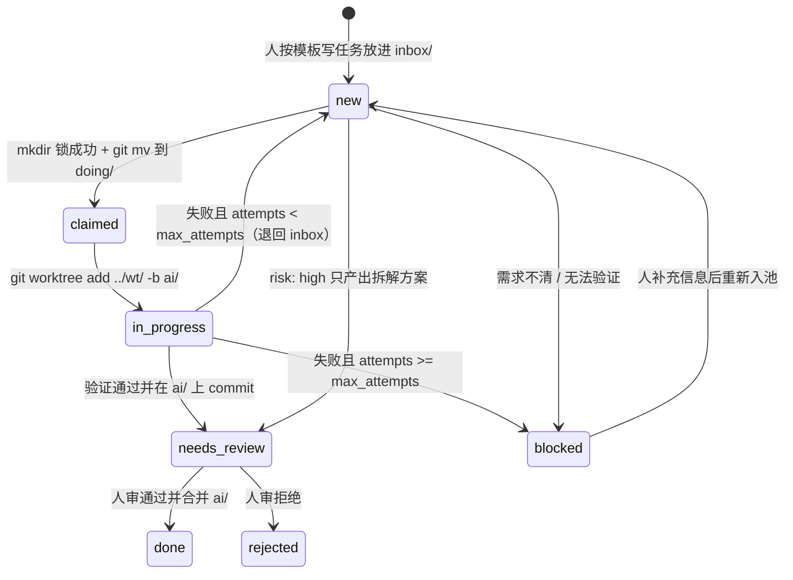
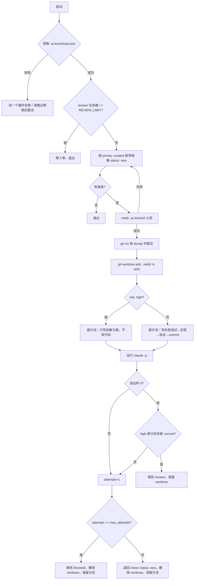

# 架构说明

本仓库用「本地 markdown 任务池 + 独立 worktree」驱动 AI 循环。核心约束：**AI 只产出结果，合并不自动化**。
本文件说明目录职责、任务流转、文件格式、两种运行方式、可调参数和尚未验证的风险。

参考来源：`docs/reference/magpie-ai-loop-guide.md` 第 5 节「落地方案」。

## 1. 目录与文件职责

```
.
├── CLAUDE.md                 # 只做 import：@AGENTS.md @LESSONS.md
├── AGENTS.md                 # agent 总规则：路由表、工作循环、硬性护栏、自检
├── LESSONS.md                # 错题本：规则/原因/证据/Seen N×
├── README.md                 # 人看的快速开始
├── .claude/
│   └── loop.md               # /loop 的循环提示词（每轮一个任务）
├── .ai/
│   ├── inbox/                # 人写的新需求/bug（status: new）
│   ├── doing/                # 已被认领（status: claimed / in_progress）
│   ├── review/               # 等人工审查（status: needs_review），附验证记录
│   ├── done/                 # 人确认合并后归档
│   ├── blocked/              # 失败达上限、需求不清、需要人决策
│   ├── templates/task.md     # 任务模板（需求/bug 通用）
│   └── inbox/EXAMPLE-*.md    # 格式示例，status: example，不会被领取，可删
├── scripts/ai-loop.sh        # claude -p 无人值守脚本（每次最多 1 个任务）
└── docs/
    ├── ARCHITECTURE.md       # 本文件
    └── reference/            # 原始参考资料（当前缺失）
```

运行时产物（已 gitignore）：

| 路径 | 作用 |
| --- | --- |
| `.ai-locks/<id>/` | 单任务认领锁（`mkdir` 原子性） |
| `.ai-locks/loop.lock/` | 脚本全局锁，保证同机只有一个循环实例 |
| `.ai-logs/<id>.result.json` | `claude -p --output-format json` 的输出 |
| `.ai-logs/<id>.stderr.log` | agent stderr |
| `../wt/<id>/` | 任务 worktree（默认在仓库外，避免污染主仓库） |

> worktree 默认放在仓库外 `../wt`，所以不需要写进 `.gitignore`；如果把 `WORKTREE_ROOT` 改到仓库内，记得在 `.gitignore` 加对应目录。

## 2. 任务生命周期



规则：

- **目录即状态**。`status` 字段必须与所在目录一致，不一致视为异常，人工移到 `blocked/`。
- agent 不直接改主仓库代码；所有代码改动在 `../wt/<id>`，分支 `ai/<id>`。
- 任务文件由脚本在主 checkout 维护状态；agent 只向「AI 记录区」追加记录。
- **合并由人执行**。脚本和 agent 都不执行 `git merge`、`git push`。
- `review/` 达到上限（默认 3）时，循环停止领取新任务，避免堆积。

## 3. 任务文件格式

路径与命名：`.ai/inbox/<id>.md`，`id` 形如 `T-20261110-001`，分支为 `ai/<id>`。

front-matter 字段（由 `.ai/templates/task.md` 定义）：

| 字段 | 说明 | 谁维护 |
| --- | --- | --- |
| `id` | 唯一，日期-序号，与文件名一致 | 人 |
| `type` | `bug` / `feature` / `chore` | 人 |
| `title` | 一句话 | 人 |
| `status` | `new` → `claimed` → `in_progress` → `needs_review` → `done` / `blocked` / `rejected` | 脚本 / agent |
| `priority` | `P0` 最高 | 人 |
| `created` | 日期，用于排序 | 人 |
| `claimed_by` / `claimed_at` | 认领人或会话 | agent / 脚本 |
| `attempts` / `max_attempts` | 失败次数 / 上限，达上限进 `blocked/` | 脚本 / agent |
| `branch` | 固定 `ai/<id>` | 人 |
| `budget_usd` | 单任务预算，对应脚本 `MAX_BUDGET_USD` | 人 |
| `risk` | `low` / `high`；high 只出方案 | 人 |

正文分三段：`背景 / 现象`、`验收标准（必须可验证）`、`不要做`，最后是「AI 记录区」（拆解 / 验证记录 / 失败记录）。

区分需求与 bug 靠 `type` 和「背景」写法：bug 写复现步骤、环境、期望 vs 实际；feature 写用户问题、现状、为什么现在做。
验收标准必须是可执行命令或可观察结果，禁止「基本可用」这类描述。

## 4. 两种运行方式

### 4.1 `/loop`（交互会话内）

在主 checkout 启动 Claude Code，然后：

```
/loop 30m
```

每 30 分钟按 `.claude/loop.md` 跑一轮；直接 `/loop` 则由模型自选间隔。也可以手动触发一轮：

```
按 .claude/loop.md 处理一个任务
```

注意：

- `/loop` 依赖会话保持打开，任务 7 天后过期。
- `/loop` 的认领只有 `.ai-locks/<id>` 一道锁，适合单会话白天盯着跑。
- 每日复盘可以另开一个循环：`/loop 1d 复盘 .ai/review、.ai/blocked 和 ai/* 分支，更新 LESSONS.md`。

### 4.2 `scripts/ai-loop.sh`（`claude -p` 无人值守）

```bash
DRY_RUN=1 scripts/ai-loop.sh    # 只打印候选任务，不改状态
scripts/ai-loop.sh              # 处理一个任务
```

配合 cron / launchd 定时调用，或用 while 循环限流（脚本每次只做一个任务就退出）。

脚本流程：



成功判定：

- `risk: low`：`claude` 退出码为 0 **且** `ai/<id>` 分支上出现新 commit。
- `risk: high`：退出码为 0 即视为完成（不要求 commit，预期没有代码改动）。
- 其余情况一律按失败处理（`attempts + 1`）。

## 5. 可调参数

全部集中在 `scripts/ai-loop.sh` 顶部，均可用同名环境变量覆盖。

| 变量 | 默认值 | 作用 | 调大会怎样 |
| --- | --- | --- | --- |
| `AI_DIR` | `.ai` | 任务池目录 | 一般不改 |
| `REVIEW_LIMIT` | `3` | `review/` 待审上限 | 队列更深，人审压力更大 |
| `MAX_ATTEMPTS_DEFAULT` | `2` | 任务未写 `max_attempts` 时的失败上限 | 重试更多，可能空耗额度 |
| `WORKTREE_ROOT` | `../wt` | worktree 根目录 | 放仓库内需同步改 `.gitignore` |
| `LOCK_ROOT` | `.ai-locks` | 锁目录 | 一般不改 |
| `LOG_ROOT` | `.ai-logs` | 日志目录 | 一般不改 |
| `LOCK_STALE_MINUTES` | `120` | 锁过期时间（分钟） | 越长越保守，崩溃后恢复越慢 |
| `CLAUDE_BIN` | `claude` | CLI 路径 | 多版本切换用 |
| `CLAUDE_MODEL` | 空（CLI 默认） | 模型，如 `claude-sonnet-5-5` | 贵模型质量高、成本高 |
| `MAX_TURNS` | `60` | 单任务最大轮数 | 更复杂任务需要更大 |
| `MAX_BUDGET_USD` | `3` | 单任务预算 | 仅 API 计费有意义 |
| `LOOP_GUIDE` | `.claude/loop.md` | 提示词引用的规则文件 | 一般不改 |
| `ALLOWED_TOOLS` / `DISALLOWED_TOOLS` | 见脚本 | 工具白/黑名单 | 按项目技术栈增删 |
| `DRY_RUN` | `0` | 只看候选 | 调试用 |
| `CLAIMED_BY` | `ai-loop-<时间戳>` | 认领人标识 | 手动指定便于追踪 |

单个任务还可以在 front-matter 里覆盖 `max_attempts`、`budget_usd`、`risk`。

### 规则调整位置

| 想改什么 | 改哪里 |
| --- | --- |
| agent 工作流 / 状态迁移步骤 | `.claude/loop.md`、`AGENTS.md` 第 2 节 |
| 硬性护栏（不许做什么） | `AGENTS.md` 第 3 节、脚本 `DISALLOWED_TOOLS` |
| review 上限、失败上限 | 脚本 `REVIEW_LIMIT`、`MAX_ATTEMPTS_DEFAULT`；单任务用 `max_attempts` |
| 允许 agent 跑哪些命令 | 脚本 `ALLOWED_TOOLS` / `DISALLOWED_TOOLS`（建议收窄到项目实际命令） |
| 任务字段 / 验收标准写法 | `.ai/templates/task.md` |
| 错题升级为规则 | `LESSONS.md` → `AGENTS.md` 或模板「不要做」 |
| 高风险定义 | `AGENTS.md` 第 3 节、模板 `risk` 注释 |

## 6. 人工操作

```bash
# 查看待审任务与分支
ls .ai/review/
git worktree list
git log --oneline -n 5 ai/<id>
git diff main...ai/<id>

# 审查通过后合并（示例，按项目分支名调整）
git merge --no-ff ai/<id>
git worktree remove ../wt/<id>
git branch -d ai/<id>
git mv .ai/review/<id>.md .ai/done/<id>.md
git commit -m "ai: done <id>"

# 被拒绝
git worktree remove --force ../wt/<id>
git branch -D ai/<id>
# 任务移到 .ai/review/ 或 .ai/blocked/ 除外，标记 rejected

# 清理残留
git worktree prune
find .ai-locks -mindepth 1 -maxdepth 1 -type d -mmin +120
```

`blocked/` 里的任务：人补充信息、改 `status: new`、移回 `inbox/` 即可重新入池；`attempts` 记得清零或调大 `max_attempts`。

## 7. 未验证与风险

本次初始化**没有运行** `claude` 或 `scripts/ai-loop.sh`，以下均为静态推断或来自指南的声明：

1. **CLI 参数未实测**：`--permission-prompts none`、`--allowedTools`、`--disallowedTools`、`--max-budget-usd`
   按指南 5.4 写入，未在本机 Claude Code 版本上验证。第一次运行前建议先去掉不确定的参数试跑一轮。
2. **agent 跨 worktree 写任务文件**：脚本把主 checkout 的任务文件绝对路径写进提示词，依赖 `acceptEdits`
   权限和 agent 遵守指令。agent 若把 `.ai/` 文件 commit 到自己分支，人工合并时可能和主仓库的状态迁移冲突；
   提示词已明确禁止，但无技术强制。
3. **成功判定偏保守**：low risk 必须有新 commit，agent 改完不提交会被判失败并消耗一次 `attempts`。
4. **额度控制**：`--max-budget-usd` 只在 API 计费下生效；订阅用户实际靠 `MAX_TURNS`、每轮一个任务和调用频率控制。
5. **并发**：全局锁只覆盖脚本实例；`/loop` 会话与脚本同时运行只靠单任务 `mkdir` 锁，claim 与 worktree 创建之间仍有一个很短的时间窗。
6. **锁恢复**：只自动清理超过 `LOCK_STALE_MINUTES` 的空锁目录；非空锁目录需要人工处理。
7. **越权拦截只在提示词 + 工具黑名单层**：没有 `.claude/settings.json` 的 `permissions.deny` 和 `PreToolUse` hook。
   需要更强护栏时应在主 checkout 补 settings / hooks（未实现）。
8. **状态一致性无自动校验**：`status` 与目录不一致目前靠 agent 或人工发现。
9. **worktree 默认在仓库外**：`../wt` 不参与版本控制，也不会被 `.gitignore` 覆盖；换机器或多仓库并跑时注意目录冲突。
